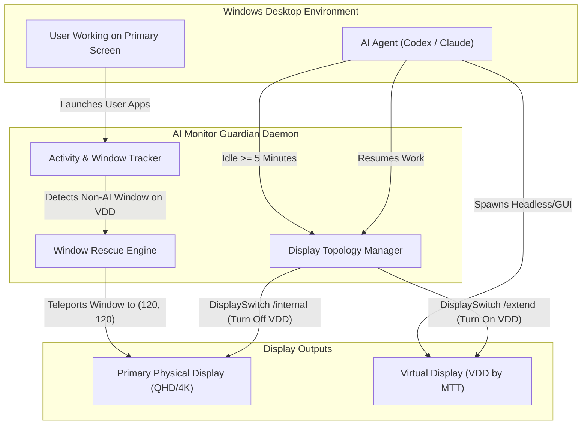

# 🖥️ AI Monitor Guardian (가상 모니터 가디언)

> **AI 에이전트(Codex, Claude, Playwright) 백그라운드 작업을 위한 가상 모니터 자동 관리 & 창 실종 방지·화질 보호 시스템**  
> Developed by **김근후 (GeunHu Kim / delight0517)** • Released under **MIT License**

[](LICENSE)
[]()
[]()

---

## 📌 배경 및 문제 의식 (Why AI Monitor Guardian?)

현대 AI 코딩 에이전트(Codex, Claude Desktop, Antigravity, Playwright 등)는 사용자의 작업을 방해하지 않기 위해 **가상 디스플레이(Virtual Display Driver, VDD)** 영역에서 백그라운드 브라우징 및 GUI 자동화를 수행합니다.

그러나 가상 모니터를 사용할 때 다음과 같은 치명적인 문제가 발생합니다:
1. **사용자 창 실종 (Window Hijacking)**: Windows는 새 창을 띄울 때 활성 스크린에 배치하므로, 사용자가 킨 브라우저, 탐색기, 피그마 등이 가상 모니터로 빨려 들어가 모니터 화면에서 사라집니다.
2. **실제 모니터 화질 저하 (Resolution Degradation)**: 시중의 가상 디스플레이 드라이버는 기본 설정이 `800x600 @ 30Hz`로 잡혀 있어, 절전 모드나 화면 전환 시 사용자의 실제 고화질 모니터(QHD/4K)까지 800x600의 흐리고 거대한 화면으로 다운스케일링됩니다.
3. **가상 모니터의 24시간 상시 점유 (Resource Waste)**: AI 작업이 끝난 후에도 가상 모니터가 계속 켜져 있어 GPU 자원을 낭비하고 화면 간섭을 일으킵니다.

**AI Monitor Guardian**은 이 3가지 문제를 100% 완전 자동화로 해결합니다.

---

## ✨ 핵심 기능 (Key Features)

### 1. 🛡️ 실시간 사용자 창 구출 (Zero Lost Windows)
- 오직 AI 백그라운드 프로세스(`codex`, `conhost`, `playwright`, `mcp` 등)만 가상 모니터에 머물도록 허용합니다.
- 사용자의 일반 앱(Chrome, Edge, Notion, Figma, VS Code, 카카오톡, 탐색기 등)이 가상 모니터 영역으로 넘어가면 **0.5초 이내에 실제 메인 모니터 정면으로 즉시 자동 구출(Rescue)**합니다.

### 2. ⚡ 5분 미사용 시 자동 종료 (Auto-Park & Auto-Wake)
- Codex 및 AI 프로세스의 CPU 사용량과 작업 상태를 실시간 모니터링합니다.
- **AI 작업 중**: 가상 모니터 작업 공간을 활성화(`DisplaySwitch /extend`) 상태로 유지합니다.
- **5분(300초) 이상 미사용 시**: 가상 모니터에 남은 창을 메인 화면으로 대피시킨 뒤, 자동으로 가상 모니터를 끄고 실제 모니터 전용 모드(`DisplaySwitch /internal`)로 전환하여 GPU 자원을 확보하고 실제 모니터의 화질을 온전하게 보존합니다.
- **AI 재작업 시**: 즉시 가상 모니터를 다시 켜서 작업 공간을 제공합니다.

### 3. 💎 고화질 네이티브 해상도 고정 (No 800x600 Blur)
- 가상 디스플레이의 800x600 저해상도 설정을 원천 차단하고 **2560x1440 (QHD) @ 60Hz** 및 **1920x1080 (FHD) @ 60Hz**로 자동 구성합니다.
- Windows가 가상 디스플레이와 실제 디스플레이를 전환하더라도 메인 화면의 해상도나 DPI 스케일링이 망가지지 않습니다.

### 4. 🪶 초경량 0토큰 무점유 구동 (< 0.1% CPU)
- 상위 LLM 토큰 소모 0원, 0토큰 순수 Win32 API 기반 초고속 동작.
- 백그라운드 RAM 점유 약 15MB, CPU 점유율 0.1% 미만의 초경량 데몬.

---

## 🏗️ 아키텍처 (Architecture)



---

## 🚀 빠른 시작 (Quick Start)

### 1. 요구 사항
- Windows 10 또는 Windows 11
- Python 3.10+
- (선택) [Virtual Display Driver (by MikeTheTech)](https://github.com/itsmikethetech/Virtual-Display-Driver) 설치 환경

### 2. 설치
```bash
git clone https://github.com/delight0517/ai-monitor-guardian.git
cd ai-monitor-guardian
pip install -r requirements.txt
```

### 3. 상시 가동 등록 (윈도우 부팅 시 자동 실행)
```bash
python guardian_cli.py install
```
> 백그라운드 무점유 `pythonw.exe`로 등록되어 화면 깜빡임이나 콘솔 창 없이 조용하게 상시 실행됩니다.

---

## 🛠️ CLI 사용법 (Commands)

```bash
# 현재 모니터 배치, Codex 활동 상태, 데몬 실행 여부 확인
python guardian_cli.py status

# 가상 모니터로 숨겨진 모든 사용자 창 즉시 메인 화면으로 구출
python guardian_cli.py rescue

# 수동으로 가상 모니터 켜기 (화면 확장)
python guardian_cli.py on

# 수동으로 가상 모니터 끄기 (물리 모니터 전용 모드)
python guardian_cli.py off

# 자동 실행 등록 해제 및 데몬 중지
python guardian_cli.py uninstall
```

---

## 📄 라이선스 (License)

이 프로젝트는 [MIT License](LICENSE)에 따라 자유롭게 사용, 수정, 배포할 수 있습니다.  
Copyright (c) 2026 **김근후 (GeunHu Kim / delight0517)**
